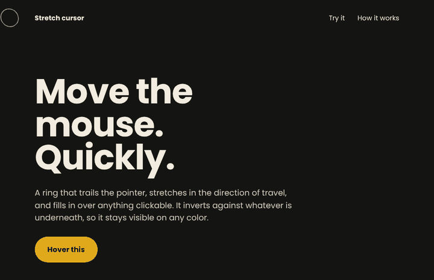

# Stretch cursor

A custom cursor with elastic movement and a fill-in hover. One file, no plugins, no libraries.

**[Try the live demo](https://kylecovey.github.io/stretch-cursor/)**

## What it does

- **Movement physics.** A ring trails the pointer with a slight delay, then catches up. It stretches along the direction of travel, and the faster you move, the more it stretches.
- **Hover effect.** Over links, buttons and form fields the ring grows and fills in.
- **Stays visible.** It inverts against whatever is underneath, so it reads on any background color.

## Install

1. Open [`cursor.html`](cursor.html) and copy the whole file.
2. Paste it just before the closing `</body>` tag of your page.
3. If you are using a site builder, paste it into its custom code field for the footer or end of body instead.
4. Scroll to the bottom of what you pasted and check the last line is `</script>`. If the paste got cut off, nothing will run.

## Who gets it and who doesn't

- **Mouse users:** yes.
- **Phones and tablets:** no. Touch screens keep their normal behavior.
- **Reduced motion:** people with that setting turned on get the ring without the trailing or the stretch.
- **Enlarged system cursors:** this hides the native cursor, so anyone who has made theirs bigger in their operating system loses that on your site. Worth knowing before you ship it.

## Change the look

Everything visual is in the `<style>` block at the top of `cursor.html`.

| To change | Edit |
|---|---|
| Ring size | `width`, `height` and `margin` on `.kc-ring` (margin is minus half the size) |
| Line weight | `border` on `.kc-ring` |
| Hover size | `scale(1.8)` on `.kc-hover .kc-grow` |
| How much it stretches | `speed / 300` in the script. A smaller number stretches more. |
| How far it trails | `0.17` in the script. Smaller trails further behind. |

## Credits

Designed and directed by [Kyle Covey](https://kylecovey.com). Built with Claude.

The stretch behavior is a riff on [this ring cursor demo by gusevdigital on CodePen](https://codepen.io/gusevdigital/pen/MWxyXRa).

## License

MIT. Use it, change it, ship it.
